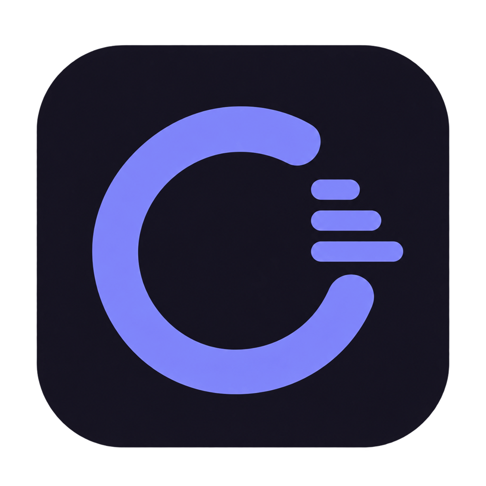
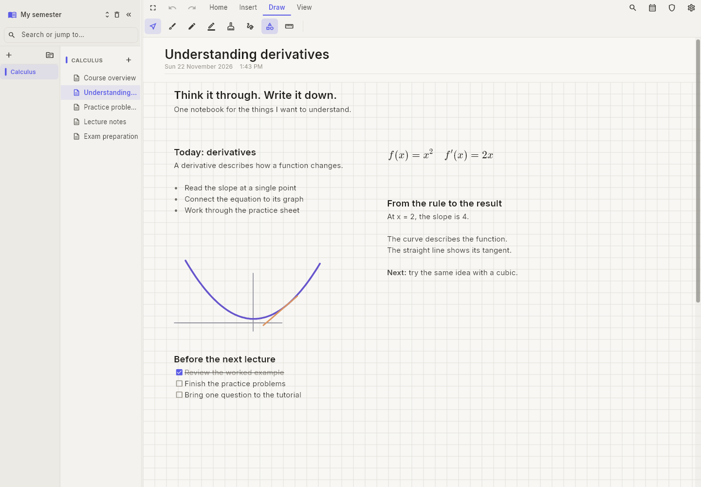
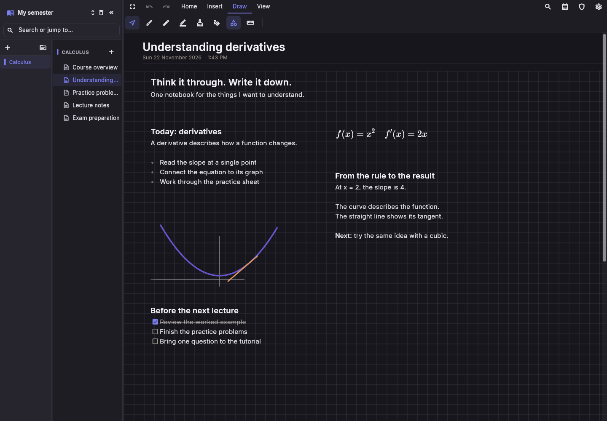
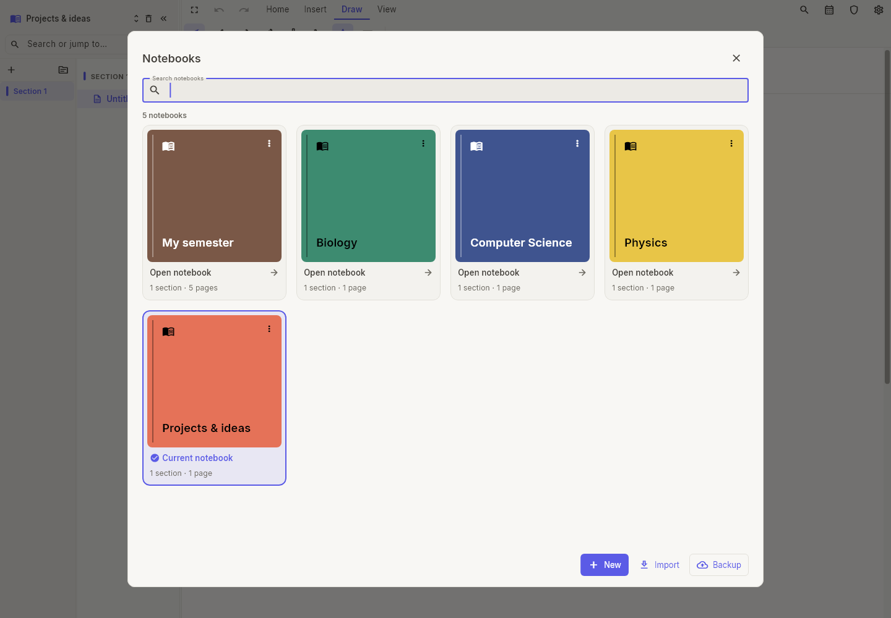
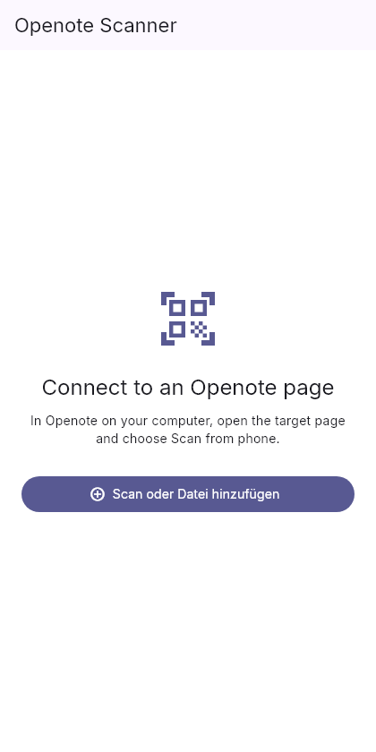
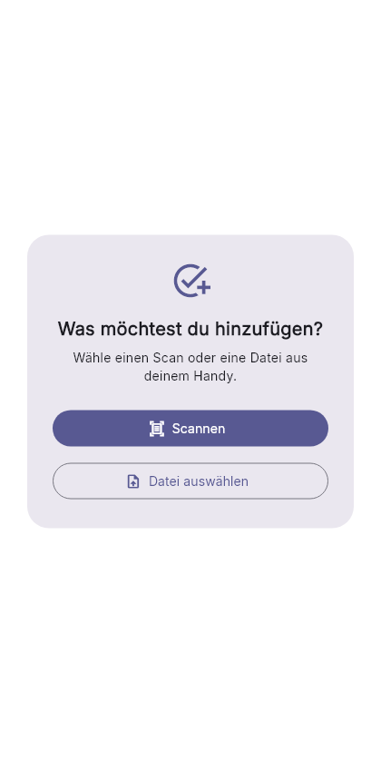

<p align="center">
  <a href="https://kingdaniel4747.github.io/openote/"></a>
</p>

<h1 align="center">Openote</h1>

<p align="center">
  <strong>A free, open-source OneNote alternative for Windows pen and touch.</strong><br>
  Handwritten notes. PDF annotation. Your whole semester.<br>
  Local notebooks. No required account. No subscription.
</p>

<p align="center">
  <a href="https://github.com/Kingdaniel4747/openote/releases/latest"></a>
  
  
  
  
  <a href="LICENSE"></a>
</p>

<p align="center">
  <a href="https://github.com/Kingdaniel4747/openote/releases/latest"></a>
  <a href="https://github.com/Kingdaniel4747/openote/releases/latest"></a>
</p>

<p align="center">
  <a href="https://github.com/Kingdaniel4747/openote/releases/latest"><b>Download macOS DMG</b></a> ·
  <a href="https://github.com/Kingdaniel4747/openote/releases/latest"><b>Download Linux DEB / RPM</b></a>
</p>

<p align="center">
  <a href="https://kingdaniel4747.github.io/openote/"><b>Website</b></a> ·
  <a href="#quick-start">Quick start</a> ·
  <a href="https://kingdaniel4747.github.io/openote/features.html">Features &amp; guide</a> ·
  <a href="#features">Features</a> ·
  <a href="#android-scanner">Android scanner</a> ·
  <a href="#learn-with-your-ai-client">AI connection</a> ·
  <a href="#importing-from-onenote">OneNote import</a> ·
  <a href="https://github.com/Kingdaniel4747/openote/releases">What’s new</a> ·
  <a href="https://github.com/Kingdaniel4747/openote/issues">Report an issue</a>
</p>

<p align="center"><br><sub>The current Windows interface, rendered with sample course material.</sub></p>

## A notebook you can actually work in

Write down the lecture. Solve the exercise on the PDF. Keep the explanation,
your working and the next question together.

Openote is a workspace for **handwriting, documents and learning on Windows**.
It is built for the way you use a pen-enabled laptop or convertible at school,
university or your desk. The Android companion brings paper and phone files
straight onto the page you already have open.

**Local notebooks. No required account. No subscription.** If you want a
GoodNotes-like way to study on Windows, try Openote. It has its own feature set
and is independent of Microsoft and GoodNotes.

If Openote helps you study, a [GitHub star](https://github.com/Kingdaniel4747/openote)
helps other pen-and-paper thinkers discover the project.

## Features

<table>
  <tr>
    <td width="33%" valign="top"><h3>Think with your pen</h3>Pen, ballpoint, highlighter and a precise eraser. Touch to pan and zoom. Windows palm rejection gives the pen priority. Undo and redo keep experiments reversible.</td>
    <td width="33%" valign="top"><h3>Work on your PDFs</h3>Import course material, mark the important part and write your solution on the page. Export your work as PDF when it is time to share it.</td>
    <td width="33%" valign="top"><h3>Organize the semester</h3>Notebooks, sections, pages and subpages, with a planner for assignments, tasks and exams. Text, formulas, tables, pictures and attachments can live together.</td>
  </tr>
  <tr>
    <td valign="top"><h3>Keep your own files</h3>Local storage, complete notebook backups and exports including PDF, Markdown, JSON Canvas and InkML. No cloud server required for your notebooks.</td>
    <td valign="top"><h3>Bring paper along</h3>Scan a document or choose a phone file with the Android companion. Pair by QR code and send it directly to your selected Windows page over the local network.</td>
    <td valign="top"><h3>Let your AI read along</h3>Optional, read-only MCP access for a compatible desktop AI client. Share a page or one notebook, including page images with handwriting and PDF annotations.</td>
  </tr>
</table>

### The same thoughts, in a different light

Switch between light and dark themes. Change tools without moving your work
somewhere else: handwriting, text, formulas and checklists share the page.

<p align="center"></p>

### A semester, sorted

Give each subject its own notebook. Search the library, pick a cover color and
keep sections and pages in the order that makes sense to you. New, Import and
Backup stay within reach.

<p align="center"></p>

Screenshots show the **real current app UI with disposable sample data**, rendered
from the app’s widgets. They are not conceptual mockups or personal notebooks.

## Downloads

| App | Get it | What to choose under release Assets |
|---|---|---|
| **Openote for Windows** | [Latest Windows release](https://github.com/Kingdaniel4747/openote/releases/latest) | `openote-<version>-windows-x64-setup.exe` |
| **Openote for macOS** | [Latest macOS release](https://github.com/Kingdaniel4747/openote/releases/latest) | `openote-<version>-macos-universal.dmg` |
| **Openote for Linux (x64)** | [Latest Linux release](https://github.com/Kingdaniel4747/openote/releases/latest) | `openote-<version>-linux-amd64.deb` or `openote-<version>-linux-x86_64.rpm` |
| **Openote Scanner for Android** | [Latest Android release](https://github.com/Kingdaniel4747/openote/releases/latest) | `openote-scanner-<version>.apk` |

**Windows:** download and run the setup. The published desktop package is x64,
not a native Arm64 build. Use a compatible pen-enabled device for handwriting:
for example a Surface, Galaxy Book 360, or a Yoga or ThinkPad model with pen
support. The writing experience depends on the hardware; not every model is tested.

**Android:** open the APK on your phone and allow installation from that source
if prompted. Use the packages from this repository. Android 6 or later is required.
This is a companion scanner, not a full Android notebook editor.

**macOS (initial support, macOS 12 or later):** the release workflow now builds a
universal DMG for Apple Silicon (M-series) and Intel Macs. Open the downloaded
DMG and drag Openote into Applications. The package
is ad-hoc signed, without an Apple Developer ID or notarization. If macOS blocks
it, try opening the installed app once, then use **System Settings → Privacy &
Security → Open Anyway** if offered. Only approve a package you downloaded from
this repository. macOS device checks are still pending.

**Linux (initial support, x64):** the workflow builds DEB and RPM packages with
a menu entry, icon and notebook file associations. The build uses Debian 12;
the packages require glibc 2.36 or later and libmpv.so.2. Choose the format for
your distribution and let its package manager install dependencies. For DEB,
run `sudo apt install ./openote-<version>-linux-amd64.deb`; for RPM, run
`sudo dnf install ./openote-<version>-linux-x86_64.rpm`, replacing `<version>`
with the exact downloaded version. Run the command from the folder containing
the file. After installation, launch **Openote** from the applications menu or
run `openote` in a terminal. If the file is not found, drag the downloaded RPM
or DEB into the terminal after `sudo dnf install ` or `sudo apt install `.
ARM Linux packages are not provided; Linux device checks are still pending.

All apps check GitHub for newer releases. On macOS and Linux, the update button
opens the release page. Quit Openote before replacing it in Applications or
installing a newer Linux package. Android updates must use the same signing key
as the installed app.

## Quick start

1. Install the Windows app and open notebook management.
2. Create a notebook, then a section and a page for your subject.
3. Open **Draw**, choose a pen, and write. Use **Home** for typed notes or
   **Insert** to bring in a PDF, picture or file.
4. Drag sections and pages into order. Hold a page over another for about half
   a second to preview a subpage; release to keep it, or move away to cancel.
5. Open notebook management and choose **Backup**. Select books, save the ZIP
   and keep another copy on a separate drive. Use **Import** to restore it.

| Control | What it does |
|---|---|
| **Home** | Write and format typed text |
| **Insert** | Add PDFs, images, tables, files and other material |
| **Draw** | Choose a pen, ballpoint, highlighter or eraser |
| **View** | Change page appearance and zoom |
| **Calendar icon** | Open the planner; select a day to create an entry |
| **AI icon**, beside settings | Set up read-only access for an external AI client |
| **Gear icon** | Open settings |
| **Right-click a page → Export** | Save that page as PDF, Markdown or another offered format |
| **Notebook management → Backup / Import** | Back up books, restore a backup or import a supported file |

Every explicit file export asks where to save. **Save original** saves the source:
several selected sheets of the same PDF produce one complete original PDF.
UI labels may be translated depending on your app language.

For the complete feature list and practical guides to screen clips, split screen,
page modes, PDF editing, theme-aware ink and Windows writing checks, visit the
**[Features & guide](https://kingdaniel4747.github.io/openote/features.html)**.

## Android scanner

**Your phone is the bridge between the paper on your desk and your Windows notebook.**

<p align="center">
  
  &nbsp;&nbsp;
  
  <br><sub>Actual scanner UI. Some controls currently retain German labels.</sub>
</p>

1. **On Windows:** open the destination page and choose **Scan from phone**.
   Leave its pairing window open.
2. **On Android:** open Openote Scanner and choose scanning or a file.
   Scan the QR code displayed by the Windows app.
3. **Capture or choose:** scan a paper document or select an existing phone file.
4. **Send:** the material arrives on the selected page, below existing content.

Both devices need a reachable local network, usually the same Wi-Fi. Allow
private incoming connections through the Windows firewall. A cloud server is
not required. Closing the Windows pairing window stops the receiver.

[Download the Android APK](https://github.com/Kingdaniel4747/openote/releases/latest) ·
[Scanner source](scanner/)

## Learn with your AI client

Try **“Explain my current page”** or **“Ask me questions about this notebook.”**

1. Open the **AI icon** at the top right, next to settings.
2. Enable access and choose **Current page** or **Whole notebook**.
3. Paste the text from **Copy for chat** into a desktop AI client that supports
   local MCP connections and follow its setup instructions. The text includes
   configuration for your personal Codex config; reconnect the client afterward.
4. Keep Openote open while the client reads your material.

Access is **read-only** and excludes locked pages. Page access follows the active
page, including split view; notebook access stays bound to the chosen book and
pauses when you switch books. Access turns off after an app restart. Connection
settings are kept locally; they contain a secret token and must not be committed.

Text, including PDF text, is delivered in portions. Handwriting, images and PDF
annotations are available as page images and detail crops. Handwriting is not
automatically searchable OCR. Videos, attachments and linked pages are not
automatically opened. The server listens only on `127.0.0.1`, so a browser-only
client cannot reach it. A port conflict is reported in the app.

Openote has no built-in model. Your chosen AI provider may charge separately.
Content already sent stays in the chat, and a cloud provider processes it on
its own servers.

## Importing from OneNote

Choose **Import** in notebook management to try the **limited local `.one` and
`.onepkg` importer**. It requires the optional native Rust core, which the GitHub
release workflow builds. Local builds without Cargo do not include that importer.

Not every content type or layout is supported. **Check imported pages and keep
your originals.** Full migration and faithful editing are not guaranteed. There
is no direct OneDrive integration.

## Development

Start with [PRODUCT.md](PRODUCT.md) for scope and UI behavior,
[ARCHITECTURE.md](ARCHITECTURE.md) for entry points, [TASKS.md](TASKS.md) for open
work, and [LEARNINGS.md](LEARNINGS.md) for pitfalls. [AGENTS.md](AGENTS.md) contains
the repository rules. These internal project notes are in German. Preserve
existing local changes and inspect Git status before working.

<details>
<summary><strong>Build from source and run checks</strong></summary>

For macOS, use a Mac with Xcode, CocoaPods and Flutter. Run `flutter pub get`
and `flutter run -d macos` from `app/`. The release workflow also builds the Rust
core for both Mac architectures and packages a universal DMG.

For Linux, use the [Flutter Linux toolchain](https://docs.flutter.dev/platform-integration/linux/setup),
Rust and the native development libraries listed in the Linux release job. Run
`flutter pub get` and `flutter build linux --release` from `app/`, then run
`bash packaging/linux/build-packages.sh <version> app/build/linux/x64/release/bundle`
from the repository root with `dpkg-deb` and `rpmbuild` installed.

Windows requirements: Flutter with Windows support and Visual Studio C++ desktop tools.
Locally verified: Flutter 3.47.7 / Dart 3.13.5, Visual Studio Community 2026
Insiders and CMake 4.3.1. CI uses the version declared in its workflow. Keep the
local plugin overrides in `app/pubspec.yaml`; do not patch the global Pub cache.

```powershell
cd app
flutter pub get
flutter run -d windows
```

`r` reloads, `R` restarts, `q` quits. Native C++/Rust changes require a new build.
Run Flutter commands in `app/` or `scanner/`, not the repository root.

For the OneNote importer, install Rust/Cargo, run `cargo build --release` in
`rust/onote_core/`, then rebuild Windows. Without Cargo, the app uses the Dart
core. End users do not need a Rust installation.

In each Flutter package, run `flutter analyze` and relevant
`flutter test test/<file>_test.dart`. Build Windows with
`flutter build windows --release`; Android also needs its SDK and Java.
Rust changes: `cargo test` in `rust/onote_core/`. Release scripts:
`node --test .github/scripts/*.test.mjs` from the root.
The entire historical test suite is not green; see TASKS.md. Manual pen,
touch and device checks are performed by the project owner.

Public images are reproducible with disposable data: set
`OPENOTE_PUBLICATION_SHOTS=1` and `FLUTTER_ROOT` to your Flutter SDK, then run
`flutter test test/publication_screenshots_test.dart --update-goldens` in
`app/` and `scanner/`. This renders current widgets without personal notebooks,
a phone camera or a real pairing token. Review the PNGs before committing them.

</details>

<details>
<summary><strong>Project layout and notebook portability</strong></summary>

| Path | Purpose |
|---|---|
| `app/` | Windows, macOS and Linux desktop app |
| `scanner/` | Android companion |
| `rust/onote_core/` | Optional native core and OneNote import |
| `packaging/` | Windows installer, macOS DMG and Linux DEB/RPM packages |
| `website/` | English static website and shared public screenshots |
| `.github/workflows/` | Shared releases and independent Pages deployment |

Copy complete `.onotebook` folders only while the app is closed. Startup and
notebook management discover added books and reconstruct a missing
`workspace.json`. Books in `Recycle Bin` remain deleted. Backups include
consistent database snapshots and media from older layouts. Imported copies
receive unique names such as `Physics 2.onotebook/Physics 2.onote`. Renaming in
the app changes folder and container names together; Explorer changes are
reconciled at the next scan. Generated files under `app/build/` are rebuilt.

</details>

<details>
<summary><strong>Publish the website and prepare a release</strong></summary>

The site is plain HTML/CSS/JS: serve `website/` locally to preview it. In GitHub
Settings → Pages, select **GitHub Actions**. Start **Publish website → Run workflow** in GitHub Actions to deploy to <https://kingdaniel4747.github.io/openote/>.
The old `/en/` URL redirects to the English root; there is no German site.

Download links resolve current GitHub assets, with a fallback to the latest
release page when the API is unavailable. Visible content, metadata, structured
software data and the sitemap help discovery. Link the site in GitHub About;
after publication you can verify the URL prefix in Search Console and submit
`https://kingdaniel4747.github.io/openote/sitemap.xml`. Rankings and AI
recommendations cannot be guaranteed. Google applies its normal
[SEO foundations to AI features](https://developers.google.com/search/docs/appearance/ai-features).
There are no website analytics or external fonts. A `robots.txt` under this
project subpath would not control crawlers for the domain.

**Pushes do not start builds, releases or website deployment.**
Use GitHub **Actions → Build Windows package / Build macOS package / Build Linux
package → Run workflow** to test one platform. Enter an X.Y.Z test version; the
result is under the run’s **Artifacts** (available for 7 days). These builds do
not publish a GitHub release.

For a public release, start **Actions → Main release → Run workflow**. It runs
the same three desktop builds plus the Android scanner. All four builds must
succeed before publication. The next patch version is calculated
from existing version tags and the Pubspec baseline. Enter a version override and optional notes in the manual release form if needed. Existing version tags are rejected. Runs are serialized; GitHub can
replace an older pending run when several releases are started quickly.

Before starting Main release, update the marked **Nächstes Release** section in TASKS.md
with short user-facing changes. The workflow publishes new notes, a date and
commit history. Unchanged notes are not presented as new features again; a
maintenance summary is used instead. The in-app updater reads this release body.
Agents must not push or publish without an explicit instruction.

Android signing requires `ANDROID_KEYSTORE_BASE64`, `ANDROID_KEYSTORE_PASSWORD`,
`ANDROID_KEY_ALIAS` and `ANDROID_KEY_PASSWORD` as repository secrets. Keep and
securely back up the existing signing key: changing it breaks Android updates.
Never commit the keystore or `scanner/android/key.properties`. Missing secrets
prevent the shared release; the website deploys independently.

</details>

## Project origins

This is an independently maintained continuation of
[Openote by icmric and contributors](https://github.com/icmric/openote).
This version focuses on Windows pen and touch, handwritten study notes, PDF
workflows and an Android companion scanner. The original contributors retain
credit for their work; this repository contains its own subsequent changes.
Use this repository and its linked website for this version's downloads and
support.

## Licenses

| Component | License |
|---|---|
| App, scanner and general project code | AGPL-3.0-or-later — [LICENSE](LICENSE) |
| Own Rust core | Apache-2.0 — [license](rust/onote_core/LICENSE) and [NOTICE](rust/onote_core/NOTICE) |
| Local plugins and `rust/onote_core/vendor/cab/` | MIT; retain their licenses and patch notes |
| Inter / JetBrains Mono | OFL-1.1; license texts beside the font assets |

Third-party code keeps its own license notices. The earlier format specification’s
CC0 text remains in `licenses/format-spec-CC0.txt`. The Rust core remains
independent of the AGPL app code; review dependencies accordingly. Contributions
follow the relevant component license and the existing DCO convention,
`git commit -s`.

The OneNote reader is based on Microsoft’s MS-ONESTORE/MS-ONE specifications.
`onenote.rs` (MPL-2.0) served as an external reference; it is not a dependency and
its code is not included in the Rust core.
